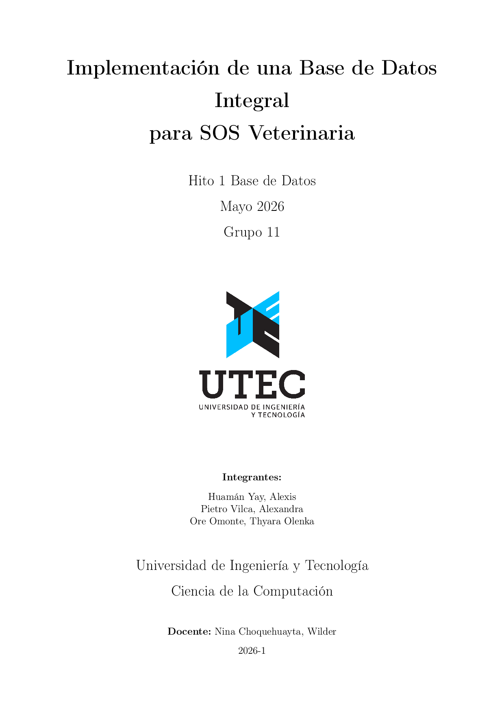

# Implementación de una Base de Datos Integral para SOS Veterinaria

[](main.pdf)

> Proyecto universitario — Hito 1 · Base de Datos · Grupo 11 · Mayo 2026

[](main.pdf)

## Descripción

Diseño e implementación de una base de datos relacional integral en **PostgreSQL** para **SOS Veterinaria**, una clínica veterinaria ubicada en Miraflores, Lima. El sistema unifica en un único sistema transaccional los procesos clínicos, farmacéuticos, logísticos y comerciales de la organización, eliminando los silos de información actualmente gestionados con hojas de cálculo y registros físicos.

El modelo abarca **26 entidades** organizadas en 6 módulos funcionales:
- Jerarquía de personas (herencia JOINED)
- Pacientes y core biológico
- Catálogos e inventario especializado
- Flujo médico (atenciones, diagnósticos, recetas)
- Servicios operativos (hospedaje, transporte)
- Facturación polimórfica y finanzas

## Contenido del informe

| Capítulo | Archivo | Contenido |
|----------|---------|-----------|
| Preliminar | `caratula.tex` | Página de título |
| Preliminar | `indice.tex` | Índice de contenidos |
| **Capítulo 1** | `requisitos.tex` | Requisitos: introducción, descripción de la empresa, necesidades, flujo actual, especificaciones del sistema, estimación de tamaño, objetivos, referencias |
| **Capítulo 2** | `modelo_ER.tex` | Modelo Entidad-Relación: reglas semánticas por módulo, diagrama ER (notación Crow's Foot), especificaciones y consideraciones (26 entidades) |
| **Capítulo 3** | `modelo_relacional.tex` | Modelo Relacional: esquemas por módulo, especificaciones de transformación (entidades, herencia, relaciones binarias/ternarias), diccionario de datos (26 tablas) |

## Compilación

```bash
pdflatex main.tex   # primera pasada
pdflatex main.tex   # segunda pasada (índice y referencias cruzadas)
```

**Requisitos:** distribución LaTeX con los paquetes `babel-spanish`, `hyperref`, `booktabs`, `tabularx`, `multirow`, `float`, `titlesec` y `geometry`.

## Estructura del proyecto

```
├── main.tex              # Archivo raíz (preámbulo e inclusiones)
├── caratula.tex          # Página de título
├── indice.tex            # Índice de contenidos
├── requisitos.tex        # Capítulo 1 — Requisitos
├── modelo_ER.tex         # Capítulo 2 — Modelo Entidad-Relación
├── modelo_relacional.tex # Capítulo 3 — Modelo Relacional
├── logo.jpg              # Logo de la universidad
├── imagen.pdf            # Diagrama Entidad-Relación
└── main.pdf              # Documento compilado
```

## Autores

- **Huamán Yay, Alexis**
- **Pietro Vilca, Alexandra**
- **Ore Omonte, Thyara Olenka**

**Docente:** Nina Choquehuayta, Wilder

**Universidad de Ingeniería y Tecnología** — Ciencia de la Computación — 2026-1
